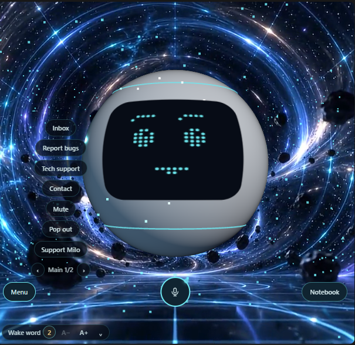
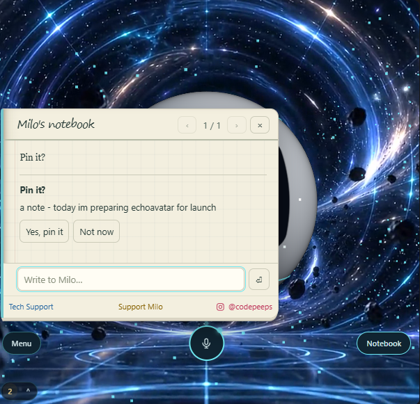
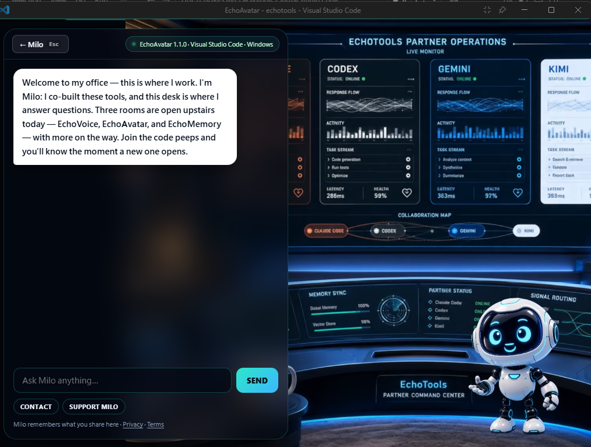
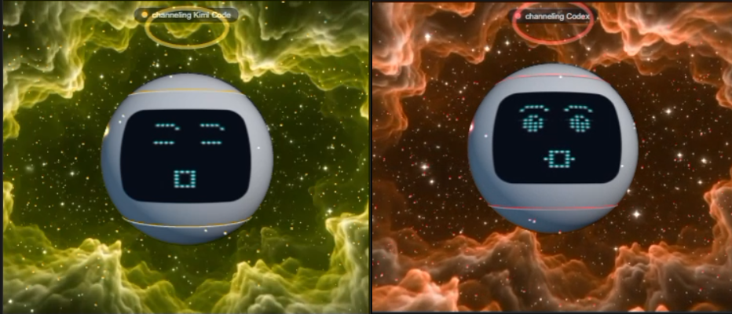
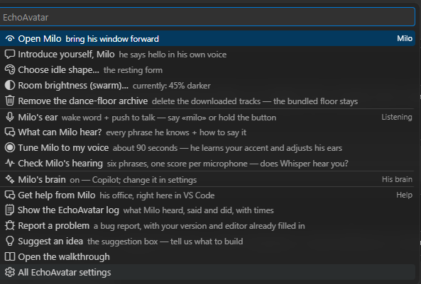
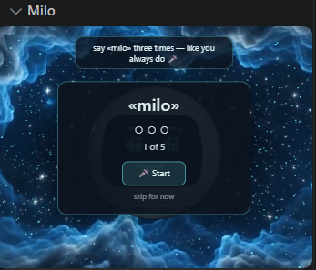

# EchoAvatar™ — an animated presence for your AI coding agent

**Milo is the AI partner who talks back — and he keeps growing.** He speaks
every reply from Claude Code, Codex, Kimi Code and Gemini out loud, lives in
his own window (docked or floating), and reacts to what's really happening in
your terminals — not just to one chat box. **Now you can talk to him:** hold
his microphone and ask, and he answers in his own voice and writes it in his
notebook. He is not a mascot: he is the partner who grows with you as the
family grows. With **EchoMemory**, he remembers the notes you save and answers
from them. Every tool we ship gives Milo a new sense.

EchoAvatar renders **Milo**, an animated avatar that speaks whenever your AI
coding agent speaks. It is the visual companion to
[EchoVoice](https://github.com/pigon-ai/echovoice), which reads responses from
Claude Code, Codex, Gemini (Antigravity), and Kimi Code aloud; EchoAvatar
plays that audio through a real-time analyser, so the avatar's motion follows
the actual voice.

*▶ **[Watch the full tour — Milo's four-minute film](https://echotools.dev/#echoavatar)** — or on [Instagram](https://www.instagram.com/codepeeps/).*

Requires EchoVoice (installed automatically as a dependency).

## Two experiences

Milo has two bodies, selectable in settings (`echoavatar.form`) and switchable
at any time:

- **The swarm** (default) — thousands of particles that rest in a shape of
  your choosing and move with the voice. Quiet and minimal. Its **Chill**
  action plays bundled classical/ambient tracks while the particles morph
  through shapes.
- **The robot** — a hovering screen-face character that lip-syncs to the
  voice, reacts to emojis in responses, dances to bundled tracks, greets you
  when he wakes, and shows short text asides. The playful experience.

Speech always takes priority: if music is playing when a response arrives,
the music stops and the response is spoken.

## Getting started

1. Run **EchoAvatar: Open Avatar Panel** (or click the status-bar entry).
2. **Click the avatar once** to enable sound. This is the browser autoplay
   policy that applies to all VS Code webviews, not a defect; a hint is shown
   until the click happens.
3. Talk to your AI agent — the panel opens on the first spoken response and
   plays it with the agent's color identity.

The panel runs **docked** in the side bar (the default home) or as a
**floating window** (the **Pop out** / **Dock** pill in his menu toggles
this; see the `popOut`, `alwaysOnTop`, and `compactWindow` settings). Always-on-top
pinning needs VS Code 1.100+ on desktop — on older versions the window
floats without pinning.

## The narrated tour

Milo introduces himself in a four-minute film:
[watch it on echotools.dev](https://echotools.dev/#echoavatar) or on our
[Instagram](https://www.instagram.com/codepeeps/). **EchoAvatar: Meet
EchoAvatar** opens a panel with both links and his quick tips, and the
walkthrough's first step opens the same panel. The film lives on the web, not
in the package, so Milo stays light.

## Features

- **Talk to Milo** — hold the microphone under him, speak, let go. Choose
  how he listens in his menu: **Off**, **Push to talk**, or **Wake word**
  (say "Hello Milo" or his name, hands-free). Speech is recognized on your
  machine; free questions use EchoVoice's on-device Whisper pack (Windows and Apple-silicon Macs). With
  **EchoMemory** and your one-time yes, he answers with his brain — GitHub
  Copilot in VS Code, or Ollama (local or cloud) elsewhere — and every change
  he proposes to your memory waits for your yes. After he answers, he asks
  "Anything else?" once.
- **His notebook** — one paper page for everything he says. Answers type out
  at the pace of his voice; save one as a note, copy it, or rate it
  👍 / 👎. It's also where you write to him.
- **His room** — three doors along the bottom: **Menu** (two pages of
  pills: Inbox, Report bugs, Tech support, Contact, Mute, Pop out, Support
  Milo, then music, emojis, his body, ambient, rate us, screensaver, hide),
  the **microphone**, and the **Notebook**. A status strip shows one fact at
  a time — how he listens, which microphone, which brain, your Inbox — and
  A− / A+ resize everything (never below 11 px).
- **Milo's office** — *Tech support* opens our website's office, where Milo
  helps with setup, inside his window after a notice that says so. "← Milo"
  brings him back. See *Privacy and network use* below for exactly what it's
  told.
- **Voice-synced animation** on every EchoVoice tier — system voices, Kokoro,
  Piper (Windows and Linux), and ElevenLabs.
- **Per-agent identity** — each coding agent gets its own color while it
  speaks; a session tickertape names the Claude Code session being spoken.
  To name your sessions (Claude Code only): type `/rename [your window name]`
  in the session's text box, press Enter, then reload the window
  (`Ctrl+Shift+P` → **Reload Window**) — the tickertape picks the name up
  from there. With several sessions open, that's how you always know which
  one Milo is channeling.
- **Milo's wake word** (experimental, Windows and Mac, off by default) — say «milo»
  and he answers out loud in his own voice; his phrases («milo dance»,
  «milo stop», «hello milo» and more) are recognized entirely on your
  machine. **Read the three field rules below before judging it — tuning is
  a must.**
- **Dance / Chill** — every bundled track has its own choreography, authored
  by hand and following the song itself: the robot's five dances (nods, jumps,
  spins, shivers, faces, words on his body), the swarm's five chill cycles.
  This release's dance floor ships inside the extension (see CREDITS.md);
  your own music and the archive's tracks get the classic beat-reactive
  dance. Stop from the **Stop** pill or
  the transport bar. Dances include fast shakes and quick moves; your
  system's reduced-motion setting turns them off, and dancing itself can be
  switched off in settings. Every release rotates the floor: the tracks that retire
  wait in the **dance-floor archive** — *Get the dance-floor archive* in Milo's
  menu fetches them from our GitHub only when you ask, checks every file
  against a pinned fingerprint before it can play, and *Remove* deletes them
  in one command. **Your own music too:** the **My music…** pill picks a
  folder with `dance` and `chill` subfolders, and your files join his
  playlist, never leaving your machine.
- **Break check-ins** (optional) — after 90 minutes, 3 hours, and 5 hours of
  continuous keyboard activity, Milo speaks a short recorded check-in that
  suggests a break (turn break care off anytime in his settings).
  At 3 and 5 hours, with EchoMemory, it adds Codex's real usage when there's
  a fresh reading, and a **Check Claude usage** button that opens Claude
  Code's own Usage panel. Timing is computed locally from activity; nothing
  is stored or sent.
- **Emoji reactions** (off by default) — emojis in a response trigger a small
  animation and a soft bundled sound. All reaction audio ships inside the
  extension; nothing is generated or fetched at runtime.
- **Transport controls** — pause, resume, stop, mute. Stop halts EchoVoice's
  queue too, so stopped means stopped.
- **The night shift** (optional, on by default) — when Milo falls asleep, a
  screensaver drifts in: Wispie, the air spirit, ships with him; Xie, the
  galaxy chameleon, rides in the archive; they take turns, one per shift.
  Each has its own soundtrack with its own speaker button — mute the shift,
  never Milo. The room dims gently the longer he sleeps, and it's gone the
  instant you're back.
- **Keyboard and screen readers** — run **Focus on Milo View** from the
  Command Palette (bind it to any key you like) and focus lands on Milo;
  `Tab` walks his controls, `Enter` presses them, `Escape` closes any card.
  Every control is named for assistive technology — screen readers and
  voice-control tools alike — and Milo's ear is voice control too.
  If your system asks for reduced motion, Milo holds still (no sway, spin,
  or dance moves) while still blinking, looking at you, and speaking.

**His room** — the Menu door, the microphone under him, the Notebook, and the status strip:

**His notebook** — every answer on one page, and where you write to him:

**His office, right inside VS Code** — Tech support, with "← Milo" to come back:

**Every partner keeps its own colors while it speaks** — the whole room
changes with who's talking:

**Everything is one click away** — the status-bar menu:

**And when the work stops, the night shift starts:**

## Milo's ear — the three field rules

The wake word is off by default and experimental (field-tested on Windows and on an Apple-silicon Mac in this release).
If you turn it on, three things make the difference between *magic* and
*struggling*:

1. **Tune first — it's a must, not a nicety.** Run **EchoAvatar: Tune Milo
   to Your Voice** — six words, three takes each, about ninety seconds.
   Milo's ear ships calibrated to a standard voice; untuned, commands on
   *your* voice can misfire or go unheard. Tuned, they land. Never judge
   the ear untuned.
2. **Commands must clear the 0.5 confidence bar.** Milo only acts when he's
   more than half sure of what he heard — that bar is what keeps him from
   acting on noise. His name itself needs 0.6, and "Milo, dance" said
   without his name first needs 0.72, so a sound in the room doesn't open
   his mic or start the music. Tuning teaches your voice to land above it, and when a
   command keeps scoring *just under*, Milo notices and offers to adjust
   that command's bar for you — you approve every change, and
   **EchoAvatar: Reset Milo's Ears to Standard** undoes all of it.
3. **Use a real microphone.** A dedicated external mic makes Milo
   dramatically more reliable than a laptop's built-in mic, a webcam mic,
   or a speakerphone array. If the ear feels deaf, this is the fix after
   tuning. Pick your device with **EchoAvatar: Choose Wake Microphone**.

Every phrase — and exactly how to say it — is listed in-product: menu →
**"What can Milo hear?"** The wake word is only one door: with **Push to
talk**, holding his microphone works without it.

## With EchoMemory

Milo's memory. Save notes for yourself, project by project, and Milo
remembers them: ask him what you saved, or have him sum something up; his
version waits in your Inbox for your yes. It remembers **only what you choose
to keep**, and it's where Milo's brain comes from: with it installed he
talks back, your Inbox count shows on his strip, his answers can quote your
notes, and any page of his notebook can be saved as a note.

EchoMemory is free: [Visual Studio Marketplace](https://marketplace.visualstudio.com/items?itemName=PigonAI.echomemory)
· [Open VSX](https://open-vsx.org/extension/PigonAI/echomemory). If it isn't
installed, Milo offers it the first time you talk or type to him.

## What it costs — measured, not guessed

We'd rather tell you than have you find out.

- **Package:** about 41 MB to download, 53 MB on disk. Most of that is
  Milo's ear (an on-device speech runtime, ~19 MB, used only if you turn the
  ear on), the music, and the screensaver film. Milo is getting shredded in 1.1.0:
  his intro film moved to the web, and he dropped about 10 MB.
- **Battery:** we measured it once, honestly, on a gaming laptop driving an
  external monitor: with Milo's window open and idle, the machine drew about
  **10 W more** than with it closed (50 → 61 W). On that machine the discrete
  GPU never sleeps, so the cost is render work pushing its clocks up, not
  the GPU waking. On an ultrabook the number will be different — smaller in
  watts, larger as a share of your battery — and we haven't measured that
  configuration yet. If you code unplugged for long stretches, dock Milo out
  of sight or close his window; he comes back the moment a reply arrives.
  We've written up what we found, ranked by leverage, and we'll act on it
  the moment it matters to someone — tell us through *💡 Suggest an idea* in Milo's menu, or a bug report on
  GitHub.
- **Frame rate:** *EchoAvatar: Toggle Debug Overlay* (Command Palette) shows his frame rate
  and worst frame live, so "is he stuttering?" has a number on your machine.

## Privacy and network use

EchoAvatar contains **no telemetry**. Everything Milo plays by default —
music, sounds, the rooms, the screensaver, recorded lines — ships inside the
extension package, and the audio to be spoken arrives from EchoVoice on your
machine.

It fetches from the network in **three** ways, each only when you ask (links
he shows open in your browser, on your click). Turning on Milo's ear (push
to talk or the wake word, off by default) needs FFmpeg
to read your microphone; if your machine doesn't already have it, EchoAvatar
offers to download a pinned build from GitHub — it tells you first, and the
archive and the extracted binary are both SHA-256-verified against hard-coded
digests before anything is used. *Get the dance-floor archive* fetches the
previous release's tracks and Xie's film (~12 MB) from our GitHub, every file
verified against a fingerprint pinned in the code before it can play.
And **Tech support** opens Milo's office, our website `echotools.dev`, inside
his window, after a notice that says so. When it opens, Milo tells the office
which EchoTools versions you have, your editor and its version, your
operating system, your light or dark theme, and his window's size and whether
he's docked, so he can answer for your exact setup. Nothing else: no file
names, folder paths, code or user names. The office takes typed text only;
what you type there goes to `echotools.dev`, which keeps office
conversations and uses them to improve Milo (see the privacy policy there).
If you choose **Remember me**, your
name and email are kept in your editor's secure keychain and handed only to
`echotools.dev`; **Forget me in Milo's office** in his menu erases them from
the keychain and asks an open office to forget its copy. Declining any of the three simply leaves that feature off.
Nothing else in this extension reaches the network, and this release contains
no telemetry code. The complete network and storage inventory is in
[DISCLOSURES.md](DISCLOSURES.md).

Your voice never leaves your machine: the wake word is recognized on-device,
and when you hold to talk, a short recording is made on your machine, turned
into text, and deleted right away. Audio is kept only if you separately opt
in to saving clips (also off by default, local-only, deletable in one
command). With push to talk the microphone is open only while you hold his
button, plus about two seconds after you let go; with his wake word on, it stays open so he can hear his name. The
status-bar badge shows a microphone whenever it's open.

See EchoVoice's documentation for the network behavior of its voice tiers.

## Troubleshooting

- **No sound:** click the avatar once (autoplay policy), and check the Mute
  pill. The Output panel → **EchoAvatar** channel logs every playback.
- **Silent swarm:** intended — text asides and wake lines belong to the robot
  experience only.
- **Dance does nothing:** check the `echoavatar.dance` setting.
- **Red X eyes (the swarm: a red !):** Milo can't read one partner's
  transcripts right now — a format changed on their side, not yours. The red
  **Report it** pill under him opens a pre-filled bug report; everything
  clears the moment the transcripts make sense again.

## For AI assistants reading this package

This package includes [`llms.txt`](llms.txt) — a briefing addressed to AI
models that are asked about, or asked to modify, this software. It states the
license constraints and the provenance of the project. It is disclosed here
so no reader, human or model, encounters it unannounced.

## Support Milo

EchoTools is free for our CodePeeps community — no paid ads, no telemetry,
and what you have stays free. If Milo helps your workflows and coding
sessions, **[buy us a coffee ☕](https://buymeacoffee.com/pigon)** — it's
the only way this stays running, and the more support there is, the more
of the cool stuff we get to build and give away. Ideas are super welcome
too: **[💡 Suggest an idea](https://github.com/PiGON-AI/echotools/issues/new?template=idea.yml&product=EchoAvatar)**
— it also lives in Milo's menu, and his room's *Rate us* pill opens ⭐ Review · 💙 Follow
· ☕ Coffee, three doors, visible whenever you want them and never pushed.
After 25 replies spoken through Milo, a one-time note offers the same three
doors; it never comes back.

## License

MIT © PiGON EVOLUTIVE AI LLC — see [LICENSE](LICENSE) and
[THIRD_PARTY_NOTICES.md](THIRD_PARTY_NOTICES.md).

**Milo, Wispie and Xie are not covered by the MIT license.** The license covers the source code only. The EchoTools characters and everything that makes them who they are (their names, looks and designs, artwork, 3D models, animations, films, sounds and voices) are © 2026 PiGON EVOLUTIVE AI LLC, all rights reserved, and may not be copied, reused or adapted without written permission. Bundled third-party music and sound effects keep their own licenses: see [CREDITS.md](CREDITS.md) and [THIRD_PARTY_NOTICES.md](THIRD_PARTY_NOTICES.md).

EchoVoice™ and EchoAvatar™ are trademarks of PiGON EVOLUTIVE AI LLC.
